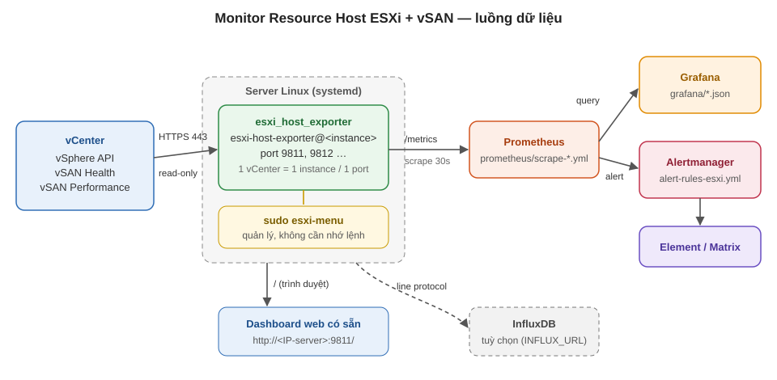

# Monitor Resource Host ESXi + vSAN — Prometheus · Grafana · Cảnh báo

Exporter Python đọc vCenter (chỉ đọc) → xuất số liệu từng host ESXi, NIC, vmk, disk vSAN, cluster
cho **Prometheus**, kèm **dashboard web có sẵn**, **dashboard Grafana**, **alert rule** và tuỳ chọn đẩy lên **InfluxDB**.

## Sơ đồ



**Các bước triển khai:** cài exporter (`deploy/`) → thêm target Prometheus (`prometheus/scrape-esxi-host-resource.yml`)
→ chép alert rule (`prometheus/alert-rules-esxi.yml`) → import Grafana (`grafana/esxi_host_resource_grafana.json`)
→ về sau cập nhật bằng `sudo esxi-menu` (mục 13 = git pull, mục 6 = file zip).

## Cấu trúc thư mục — cần gì lấy nấy

| Thư mục | Dùng khi | Nội dung |
|---|---|---|
| [`exporter/`](exporter/) | Chạy exporter (server hoặc thử trên máy) | `esxi_host_exporter.py` (chính), `vsan_disk_health.py`, `esxi_dashboard.html`, `dashboard_template.html` |
| [`deploy/`](deploy/) | Cài / gỡ / quản lý trên Linux, đóng gói offline | `install.sh`, `uninstall.sh`, `menu.sh` (lệnh `esxi-menu`), `esxi-host-exporter@.service`, `build_zip.py` |
| [`grafana/`](grafana/) | Import vào Grafana | `esxi_host_resource_grafana.json` |
| [`prometheus/`](prometheus/) | Cấu hình Prometheus | `scrape-esxi-host-resource.yml` (mẫu scrape), `alert-rules-esxi.yml` (22 rule, Mức 2 / Mức 3) |
| [`zabbix/`](zabbix/) | Dùng Zabbix thay / cùng Prometheus | `esxi_host_exporter_zbx60.yaml` (template Zabbix 6.0), `make_template.py` |
| [`docs/`](docs/) | Đọc / in / gửi | `Huong-Dan-Monitor-Resource-Host-ESXi-vSAN.docx` (hướng dẫn A–Z), `so-do-kien-truc.svg` (sơ đồ) |

## 1. Chuẩn bị

- **vCenter**: tạo user (vd `monitor@vsphere.local`), cấp role **Read-only** ở cấp vCenter, tick *Propagate to children*.
  Bật *vSAN Performance Service* trên cluster để có số liệu latency.
- **Server Linux**: có systemd, Python ≥ 3.8 (3.10+ dùng pyVmomi 9.x, 3.8/3.9 dùng pyVmomi 8.0.3 — gói zip kèm sẵn cả hai, install.sh tự chọn), tới được vCenter cổng 443:
  `curl -k -s -o /dev/null -w "%{http_code}\n" https://<IP-vCenter>/sdk/vsanServiceVersions.xml` → `200`.

## 2. Cài exporter

**Cách 1 — git clone (server có internet, tự tải `pyvmomi` bằng pip):**

```bash
cd /root
git clone https://github.com/fixnhanh-linux/monitor-grafana-vcenter-full-details-prometheus.git
cd monitor-grafana-vcenter-full-details-prometheus
sudo bash deploy/install.sh
```

Thiếu pip: `apt install python3-pip` hoặc `dnf install python3-pip`.

**Cách 2 — gói zip (server không có internet, `pyvmomi` kèm sẵn):**

```bash
python deploy/build_zip.py          # tren may co Python + pyvmomi -> esxi-host-exporter-linux.zip + .sha256
scp esxi-host-exporter-linux.zip esxi-host-exporter-linux.zip.sha256 root@<IP-server>:/home/
# tren server:
cd /home && sha256sum -c esxi-host-exporter-linux.zip.sha256      # phai la OK
unzip -o esxi-host-exporter-linux.zip && cd esxi-host-exporter && sudo bash install.sh
```

`install.sh` hỏi: tên instance (vd `pool18`), IP vCenter, user, cluster (`-` = tất cả), port (9811), chu kỳ (60s),
mật khẩu (gõ ẩn). Mỗi vCenter cài 1 instance với **tên và port khác nhau**.

- Mật khẩu lưu ở `/etc/esxi-host-exporter/<instance>.env` (quyền `600`), chạy dưới user hệ thống `esxi-exporter`.
- Sai mật khẩu → service dừng hẳn (không thử lại, tránh khoá tài khoản vCenter).
- Dashboard web có sẵn: `http://<IP-server>:9811/`.

## 3. Quản lý — quên lệnh thì gõ `sudo esxi-menu`

```
 1) Trang thai tat ca instance        8) Doi mat khau / cai lai 1 instance
 2) Xem log 1 instance                9) Sua cau hinh (.env) 1 instance
 3) Restart 1 instance               10) Xem cau hinh InfluxDB (token da an)
 4) Restart tat ca instance          11) Go 1 instance
 5) Kiem tra phien ban dang chay     12) Cac lenh hay dung
 6) Cap nhat ban moi tu file zip     13) Cap nhat ban moi tu GitHub (git pull)
 7) Them vCenter / instance moi      14) Sinh / cai cau hinh Prometheus
                                      0) Thoat
```

Kiểm tra phiên bản đang chạy: `curl -s localhost:9811/metrics | grep build_info`.

## 4. Prometheus

0. Nhanh nhất: trên server exporter chạy `sudo esxi-menu` → **14**: tự sinh cấu hình scrape từ các instance đã cài (IP + port + nhãn pool), nếu Prometheus cùng máy thì hỏi chép vào `scrape_configs/` + `rules/`, chạy `promtool check config` và reload.
1. Hoặc chép tay [`prometheus/scrape-esxi-host-resource.yml`](prometheus/scrape-esxi-host-resource.yml) vào
   `/etc/prometheus/scrape_configs/` (hoặc dán vào `scrape_configs` của `prometheus.yml`), thay `<IP-server>`, port, nhãn `pool`.
2. Chép [`prometheus/alert-rules-esxi.yml`](prometheus/alert-rules-esxi.yml) vào thư mục `rule_files`.
3. `promtool check config /etc/prometheus/prometheus.yml && systemctl reload prometheus`
   → Status → Targets: job `esxi_host_resource` **UP**.

Cảnh báo theo bảng "Chi tiết từng host trong cluster": **Mức 2 – Cao** = `severity: critical`, **Mức 3 – Cảnh báo** = `severity: warning` (thêm nhãn `muc: "2"` / `"3"`).

| Chỉ số | Điều kiện | Rule | Mức | for |
|---|---|---|---|---|
| Host Status / ESXi service | Host mất kết nối vCenter | `EsxiHostDisconnected` | 2 | 30s |
| | Hardware Health có thành phần RED | `EsxiHostHardwareError` | 2 | 0s |
| NIC | vmnic down | `EsxiVmnicDown` | 2 | 0s |
| CPU từng host | > 60% / > 40% | `EsxiCpuHigh` / `EsxiCpuWarning` | 2 / 3 | 5m |
| RAM từng host | > 90% / > 80% | `EsxiRamHigh` / `EsxiRamWarning` | 2 / 3 | 5m |
| Disk Group / Disk Health | Disk failed (RED) · DiskGroup RED | `VsanDiskFailed` · `VsanDiskGroupUnhealthy` | 2 | 0s |
| | % disk healthy < 70% / 70–80% | `VsanDiskHealthLow` / `VsanDiskHealthWarning` | 2 / 3 | 0s |
| | Disk YELLOW | `VsanDiskDegraded` | 3 | 0s |
| Disk latency | write > 30ms / > 15ms (**tạm**, chờ chốt ngưỡng theo Disk Class) | `VsanDiskLatencyHigh` / `VsanDiskLatencyWarning` | 2 / 3 | 10m |
| vSAN network latency | > 1ms / 0,5–1ms | `VsanNetworkLatencyHigh` / `VsanNetworkLatencyWarning` | 2 / 3 | 0s |
| vSAN congestion / Resync | congestion > 60 · resync > 0 | `VsanCongestion` · `VsanResyncInProgress` | 2 | 30s / 2m |
| Host maintenance | Host vào chế độ bảo trì | `EsxiHostMaintenance` | 3 | 0s |
| (khác) | Drop vmk vSAN > 0,1% | `VsanVmkPacketDrop` | 3 | 5m |
| (khác) | Exporter mất dữ liệu | `EsxiExporterStale` / `EsxiExporterDown` | 3 | 15m / 2m |

`esxi_vsan_network_latency_ms` lấy từ test "Network latency check" của vSAN health (cache vSAN health, lấy mỗi 5 phút);
vCenter không có test này thì metric không xuất hiện và 2 rule network latency không bao giờ bắn.

Gửi sang Element: route `alertname=~"Esxi.*|Vsan.*"` trong Alertmanager tới receiver Element đang dùng.

## 5. Grafana

Dashboards → New → Import → upload [`grafana/esxi_host_resource_grafana.json`](grafana/esxi_host_resource_grafana.json)
→ chọn Prometheus → chọn Cluster. Đã có bản cũ thì chọn **Overwrite**.

- **Tổng quan**: Total host / OK / Cảnh báo / Lỗi / Host maintenance / vSAN network latency max / vSAN resync / độ mới dữ liệu.
- **Bảng host**: CPU% · RAM% · **NIC UP (xanh) / NIC DOWN (đỏ)** · DiskGroup vSAN · congestion · write latency · VMs · Uptime · Status · Lý do.
- **Network**: bandwidth vmnic top 10, drop/discard vmk vSAN, vmnic DOWN.
- **Chi tiết host** và **vSAN Disk Health**: từng disk, lịch sử trạng thái, exporter theo pool.

**Status host** (khớp Mức 2 / Mức 3): ERROR khi host mất kết nối · phần cứng RED · vmnic ≥ 10Gb down · disk RED hoặc % disk healthy < 70%
· CPU > 60% · RAM > 90% · write latency > 30ms · network latency > 1ms · congestion > 60;
WARN khi maintenance · disk YELLOW · CPU > 40% · RAM > 80% · write latency > 15ms · network latency > 0,5ms · drop vmk vSAN > 0,1%.
Đổi ngưỡng trong file `.env` (WARN = Mức 3, ERR = Mức 2): `ESXI_WARN_CPU` / `ESXI_ERR_CPU`, `ESXI_WARN_RAM` / `ESXI_ERR_RAM`,
`ESXI_WARN_LATENCY_MS` / `ESXI_ERR_LATENCY_MS`, `ESXI_WARN_NET_LATENCY_MS` / `ESXI_ERR_NET_LATENCY_MS`,
`ESXI_WARN_DISK_HEALTH_PCT` / `ESXI_ERR_DISK_HEALTH_PCT`, `ESXI_WARN_CONGESTION`, `ESXI_WARN_VMK_DROP_PCT`,
`ESXI_NIC_MIN_MBPS` (mặc định chỉ theo dõi vmnic ≥ 10000 Mb/s). Đổi ngưỡng ở `.env` thì sửa luôn số trong `alert-rules-esxi.yml`.

### Zabbix 6.0

Import [`zabbix/esxi_host_exporter_zbx60.yaml`](zabbix/esxi_host_exporter_zbx60.yaml) → tạo host Zabbix trỏ IP máy exporter
→ gắn template **ESXi & vSAN Command Center** (port khác 9811 thì sửa macro `{$ESXI.EXPORTER.URL}`).
Trigger giống bảng ở mục 4 (Mức 2 = High, Mức 3 = Warning), ngưỡng là macro. Chi tiết: [`zabbix/README.md`](zabbix/README.md).

## 6. InfluxDB (tuỳ chọn)

Bỏ dấu `#` các dòng sau trong `/etc/esxi-host-exporter/<instance>.env` (hoặc menu mục 9), restart instance:

```bash
INFLUX_URL='http://<IP-influx>:8086'
INFLUX_ORG='fpt'                 # InfluxDB 2.x
INFLUX_BUCKET='vmware'
INFLUX_TOKEN='<token>'
# InfluxDB 1.x: INFLUX_URL + INFLUX_DB='vmware' (+ INFLUX_USER, INFLUX_PASSWORD)
```

Mỗi metric → measurement cùng tên, nhãn → tag, giá trị → field `value`. Log báo `InfluxDB: da gui ... dong`.
Không muốn sửa exporter: dùng Telegraf `[[inputs.prometheus]]` đọc `/metrics` rồi `[[outputs.influxdb_v2]]`.

## 7. Metric chính

| Nhóm | Metric (nhãn) |
|---|---|
| Host | `esxi_host_status` (0 OK/1 WARN/2 ERROR), `esxi_host_info` (nics_up, nics_down, reason), `esxi_host_cpu_usage_percent`, `esxi_host_mem_usage_percent`, `esxi_host_uptime_seconds`, `esxi_host_vms_running`, `esxi_host_connected`, `esxi_host_maintenance`, `esxi_host_hardware_health` |
| NIC (`nic`) | `esxi_host_nic_up`, `esxi_host_nic_speed_mbps`, `esxi_host_nic_transmit_mbps`, `esxi_host_nic_receive_mbps` |
| vmk (`vmk`, `vsan`, `direction`) | `esxi_host_vmk_drop_percent`, `esxi_host_vmk_dropped_packets` |
| vSAN host | `esxi_vsan_write_latency_ms`, `esxi_vsan_read_latency_ms`, `esxi_vsan_network_latency_ms`, `esxi_vsan_host_disk_health`, `esxi_vsan_host_disk_health_percent`, `esxi_vsan_diskgroup_health`, `esxi_vsan_host_congestion` |
| Cluster | `esxi_cluster_status`, `esxi_cluster_vsan_health`, `esxi_cluster_drs_mode`, `esxi_cluster_hosts`, `esxi_cluster_vms_total`, `esxi_cluster_cpu_total_hz`, `esxi_cluster_mem_total_bytes`, `esxi_cluster_vsan_capacity_bytes`, `esxi_vsan_resync_bytes` |
| Disk (`disk`) | `vsan_disk_health`, `vsan_disk_info` (reason), `vsan_disk_congestion_value`, `vsan_disk_used_ratio` |
| Exporter | `esxi_exporter_build_info` (version), `vsan_disk_exporter_up`, `vsan_disk_exporter_last_success_timestamp_seconds` |

Health: `0=green, 1=yellow, 2=red, 3=unknown`.

## 8. Chạy thử trên máy (không cài service)

```bash
pip install pyvmomi
cd exporter
VSAN_PASS='...' python3 esxi_host_exporter.py <IP-vCenter> monitor@vsphere.local - 9811 60
# -> http://localhost:9811/ (dashboard web), http://localhost:9811/metrics
python3 vsan_disk_health.py <IP-vCenter> monitor@vsphere.local <cluster> result.json   # chi lay health disk ra JSON
```

## Bảo mật

- Không commit mật khẩu: `.gitignore` đã chặn `.vsan_pass`, `*.env`, gói `.zip`.
- Tài khoản vCenter chỉ cần Read-only. Mật khẩu đã lộ thì đổi ngay rồi chạy lại `install.sh` (cùng tên instance).
